# EDURAH LMS — COMPREHENSIVE CODEBASE AUDIT & FEATURE ROADMAP

**Document Version:** 2.0.0  
**Target Platform:** EDURAH Learning Management System  
**Prepared For:** Engineering & Curriculum Leadership  
**Date:** September 2026  

---

## 1. EXECUTIVE SUMMARY

EDURAH has established a strong visual aesthetic, role-based navigation (Admin, Teacher, Student), strict grade partitioning, and accurate video progress tracking with Supabase synchronization. 

However, a deep audit of the entire codebase reveals critical architectural bottlenecks—most notably a **hybrid storage model where core curriculum entities (courses, lessons, subjects, quizzes) reside in browser `localStorage` rather than the Supabase PostgreSQL database**, alongside several **academic integrity, security, and missing workflow gaps** standard in modern enterprise LMS platforms (such as Canvas, Moodle, Blackboard, and Google Classroom).

This document details every issue discovered across architecture, security, data integrity, and user experience, followed by a prioritized roadmap of essential LMS features required for a scalable, institutional-grade product.

---

## 2. DETAILED CODEBASE AUDIT & ISSUES

### CATEGORY A: CRITICAL ARCHITECTURAL & DATA PERSISTENCE ISSUES

#### Issue A1: Curriculum Data Resides in Client `localStorage` (Severe Isolation & Data Loss)
* **Location:** [`src/lib/content.ts`](file:///c:/Users/Zaid%20Azeemulla/Desktop/arshia%20v2/src/lib/content.ts), [`src/app/teacher/courses/page.tsx`](file:///c:/Users/Zaid%20Azeemulla/Desktop/arshia%20v2/src/app/teacher/courses/page.tsx), [`src/app/admin/courses/page.tsx`](file:///c:/Users/Zaid%20Azeemulla/Desktop/arshia%20v2/src/app/admin/courses/page.tsx), [`src/components/quizMaker/QuizMakerComponent.tsx`](file:///c:/Users/Zaid%20Azeemulla/Desktop/arshia%20v2/src/components/quizMaker/QuizMakerComponent.tsx)
* **Finding:** When a teacher or administrator creates or edits a course, adds a video lesson, or creates a quiz, `ContentService.saveCourse()` and `ContentService.saveQuiz()` serialize this data into the browser's `localStorage` (`edurah_courses_data_v2`, `edurah_quizzes_data_v2`).
* **Consequence:**
  1. **Device Isolation:** If Teacher A on Computer 1 creates a course for Grade 6, neither the students in Grade 6 nor the Admin on Computer 2 can see that course.
  2. **Data Loss:** Clearing browser cache, using Incognito mode, or switching browsers wipes all dynamically authored courses, lessons, and quizzes.
  3. **Missing Database Tables:** In [`supabase/schema.sql`](file:///c:/Users/Zaid%20Azeemulla/Desktop/arshia%20v2/supabase/schema.sql), tables for `courses`, `chapters`, `lessons`, `quizzes`, and `questions` do not exist. Only user profiles, lesson progress, and quiz results are stored in PostgreSQL.
* **Remediation:** Migrate all course, chapter, lesson, and quiz entities into relational Supabase tables with proper foreign key constraints (`grades(id)`, `profiles(id)`), and update `ContentService` to query Supabase via REST/RPC with server-side caching.

#### Issue A2: Server-Side Node.js Fallback Causes Broken SSR & API Endpoints
* **Location:** [`src/lib/content.ts:46-54`](file:///c:/Users/Zaid%20Azeemulla/Desktop/arshia%20v2/src/lib/content.ts#L46-L54), [`src/app/api/courses/[id]/route.ts`](file:///c:/Users/Zaid%20Azeemulla/Desktop/arshia%20v2/src/app/api/courses/[id]/route.ts)
* **Finding:** In `ContentServiceClass.getStorageItem<T>()`, when running on the server (`typeof window === 'undefined'`), the method returns `defaultValue` (the static array `INITIAL_COURSES`).
* **Consequence:** Any server-side API route (like `/api/courses/[id]`) or Server Component can *never* access any course or quiz created dynamically by teachers or admins. Only the hardcoded seed courses in TypeScript are visible to the server.

---

### CATEGORY B: ACADEMIC INTEGRITY & SECURITY VULNERABILITIES

#### Issue B1: Client-Side Quiz Answer Key Exposure
* **Location:** [`src/content/quizzes.ts`](file:///c:/Users/Zaid%20Azeemulla/Desktop/arshia%20v2/src/content/quizzes.ts), [`src/components/quiz/QuizEngine.tsx`](file:///c:/Users/Zaid%20Azeemulla/Desktop/arshia%20v2/src/components/quiz/QuizEngine.tsx), [`src/types/index.ts:112-119`](file:///c:/Users/Zaid%20Azeemulla/Desktop/arshia%20v2/src/types/index.ts#L112-L119)
* **Finding:** The full `QuizQuestion` object bundled and served to the student's browser includes `correctAnswerIndex` and `explanation` *before* the student submits the assessment.
* **Consequence:** Any student can open Chrome DevTools (Inspect &rarr; Console/Network or React Component tree) and inspect `quiz.questions[i].correctAnswerIndex` to achieve a 100% score effortlessly.
* **Remediation:** Sanitization endpoint on the server. When students request a quiz, `correctAnswerIndex` and `explanation` must be stripped out. Answers must be graded exclusively on the server against the database.

#### Issue B2: Client-Supplied Answer Key in Submission API Payload
* **Location:** [`src/app/api/quizzes/submit/route.ts:105-136`](file:///c:/Users/Zaid%20Azeemulla/Desktop/arshia%20v2/src/app/api/quizzes/submit/route.ts#L105-L136)
* **Finding:** In `/api/quizzes/submit`, the server receives the `questions` array directly from the client's POST body and computes correctness using `studentAnsIndex === q.correctAnswerIndex`.
* **Consequence:** A student can submit a manipulated HTTP POST request where `q.correctAnswerIndex` is altered to match their chosen option, and the server blindly accepts it, awarding full marks.
* **Remediation:** The backend must load the authoritative quiz questions from Supabase by `quizId`, compare student answers server-side, and calculate scores securely.

#### Issue B3: Video Scrubbing Bypass of the 90% Watch Threshold
* **Location:** [`src/components/video/VideoPlayer.tsx:64-70`](file:///c:/Users/Zaid%20Azeemulla/Desktop/arshia%20v2/src/components/video/VideoPlayer.tsx#L64-L70)
* **Finding:** Watch percentage is computed as `(currentTime / duration) * 100` using `playerRef.current.getCurrentTime()`.
* **Consequence:** A student can open a 45-minute lecture video, immediately drag the seek bar to the 42-minute mark (93%), let it play for 2.5 seconds, and trigger automatic completion.
* **Remediation:** Implement cumulative watch interval tracking (e.g., set of watched ranges `[[0, 15], [30, 60]]`). Only mark a video complete when the sum of unique seconds watched equals $\ge 90\%$ of `duration`.

#### Issue B4: Manual "Mark as Complete" Button Bypasses Real Learning Requirement
* **Location:** [`src/app/courses/[slug]/lessons/[lessonSlug]/LessonControls.tsx:46-56`](file:///c:/Users/Zaid%20Azeemulla/Desktop/arshia%20v2/src/app/courses/[slug]/lessons/[lessonSlug]/LessonControls.tsx#L46-L56)
* **Finding:** On lesson pages, an active `Mark as Complete` button calls `ProgressService.toggleLessonComplete()`.
* **Consequence:** Violates Requirement 1 ("Progress must NOT simply increase because a student opens a course or lesson"). Students can manually click the button on video lessons without watching any video.
* **Remediation:** Disable or remove the manual completion toggle for video lessons; only display an informational "Watched 90% to Complete" status badge. Reserve manual completion for purely reading-based resources or text assignments.

#### Issue B5: Absence of Next.js Edge Middleware for Route Protection
* **Location:** Root workspace (no `src/middleware.ts`)
* **Finding:** Route guarding across `/admin/*`, `/teacher/*`, and `/dashboard` relies entirely on client-side React hooks (`useAuth`, `useEffect`, `router.push('/login')`).
* **Consequence:**
  1. **UI Flashing:** Unauthenticated users requesting `/admin/students` experience a brief flash of the administrative shell and layout before JavaScript executes the redirect.
  2. **No SSR Security:** Edge servers cannot reject unauthorized requests early at the network perimeter.
* **Remediation:** Implement a Next.js `middleware.ts` utilizing Supabase Auth cookie verification (`@supabase/ssr`) to redirect unauthenticated or unauthorized roles before pages render.

---

### CATEGORY C: AUTHENTICATION, SUPABASE RLS & DATA INTEGRITY

#### Issue C1: Unpaginated `auth.admin.listUsers()` Silent Truncation
* **Location:** [`src/app/api/teacher/students/route.ts:82-89`](file:///c:/Users/Zaid%20Azeemulla/Desktop/arshia%20v2/src/app/api/teacher/students/route.ts#L82-L89)
* **Finding:** `supabaseAdmin.auth.admin.listUsers()` is invoked without pagination parameters.
* **Consequence:** In Supabase, `listUsers()` defaults to 50 users per page. Once an institution registers more than 50 total accounts, students on page 2 and beyond are omitted from the metadata map, causing missing student records.
* **Remediation:** Query `public.profiles` directly with indexed columns (`eq('role', 'student').eq('grade_id', targetGrade)`), eliminating reliance on `auth.admin.listUsers()`.

#### Issue C2: Schema Drift & Split-Brain Fallback between `grade_id` and `class_group`
* **Location:** [`src/lib/auth.ts:39-45`](file:///c:/Users/Zaid%20Azeemulla/Desktop/arshia%20v2/src/lib/auth.ts#L39-L45), [`src/context/AuthContext.tsx:28-32`](file:///c:/Users/Zaid%20Azeemulla/Desktop/arshia%20v2/src/context/AuthContext.tsx#L28-L32)
* **Finding:** Several functions fall back to storing or reading `grade_id` from `class_group` when `grade_id` is missing.
* **Consequence:** If a student has `grade_id` in `class_group` but `NULL` in the `grade_id` column, database Row Level Security policies (`grade_id = public.get_teacher_assigned_grade()`) evaluate to false, rendering students invisible to teachers in Supabase queries.
* **Remediation:** Enforce `grade_id NOT NULL` at the database schema level and eliminate legacy fallback logic.

#### Issue C3: Dual-State Storage Desynchronization (LocalStorage vs Database)
* **Location:** [`src/lib/progress.ts`](file:///c:/Users/Zaid%20Azeemulla/Desktop/arshia%20v2/src/lib/progress.ts)
* **Finding:** Progress is recorded in client `localStorage` (`edurah_progress_user_${userId}`) and asynchronously posted to `/api/progress/lesson`.
* **Consequence:** If a student completes lessons on poor connectivity or switches between a mobile browser and a desktop, the local states can conflict. A database-first architecture with optimistic UI updates is needed.

#### Issue C4: Progress User API Response Shape (Fixed in this turn)
* **Location:** [`src/app/my-learning/page.tsx:34`](file:///c:/Users/Zaid%20Azeemulla/Desktop/arshia%20v2/src/app/my-learning/page.tsx#L34), [`src/app/api/progress/user/route.ts:117`](file:///c:/Users/Zaid%20Azeemulla/Desktop/arshia%20v2/src/app/api/progress/user/route.ts#L117)
* **Finding:** `/api/progress/user` previously returned `quizResults` as an object dictionary, causing `TypeError: data.quizResults.forEach is not a function` on `/my-learning`.
* **Resolution:** Fixed in this update by returning both `quizResults: Object.values(quizResults)` (array) and `quizResultsMap: quizResults` (dictionary), with safe array checks across all consuming pages.

---

## 3. ESSENTIAL FEATURES FOR A PRODUCTION-GRADE LMS

To transition EDURAH from a structured curriculum viewer into a full-scale Learning Management System (competing with Canvas, Moodle, and Blackboard), the following modules should be implemented:

```mermaid
graph TD
  A[EDURAH Core LMS] --> B[Curriculum & Content Engine]
  A --> C[Assessment & Grading Engine]
  A --> D[Communication & Social Learning]
  A --> E[Classroom & Attendance]
  A --> F[Institutional Analytics & Compliance]

  B --> B1[Database-Backed Courses & Lessons]
  B --> B2[Prerequisites & Module Sequencing]
  B --> B3[Rich Media & PDF Uploads via Supabase Storage]

  C --> C1[File Upload Homework Submissions]
  C --> C2[Teacher Rubric & Annotation Tool]
  C --> C3[Question Banks & Randomized Quizzes]
  C --> C4[Proctored Exam Security]

  D --> D1[Course Discussion Boards]
  D --> D2[Direct Messaging & Announcements]
  D --> D3[Automated Email Notifications]

  E --> E1[Live Classrooms Zoom/Meet]
  E --> E2[Automated Attendance Tracking]

  F --> F1[Teacher Gradebook with CSV Export]
  F --> F2[At-Risk Student Early Warnings]
  F --> F3[Verifiable PDF Completion Certificates]
  F --> F4[Parent / Guardian Observer Accounts]
```



---

### FEATURE MODULE 1: CURRICULUM & CONTENT INFRASTRUCTURE (DATABASE-BACKED)

| Feature | Description | Priority |
| :--- | :--- | :--- |
| **Supabase Relational Content** | Move `courses`, `chapters`, `lessons`, and `quizzes` to PostgreSQL. Enable multi-teacher collaboration without device isolation. | **P0 (Critical)** |
| **Prerequisites & Locked Sequencing** | Lock Lesson $N+1$ until Lesson $N$ is completed or passed. Enforce mastery learning progression. | **P1 (High)** |
| **Rich Learning Assets (Supabase Storage)** | Allow teachers to upload supplementary lecture notes, worksheets, lab guides, and slides (PDF, DOCX, ZIP) directly into Supabase Storage buckets with secure signed URLs. | **P1 (High)** |
| **Section & Cohort Management** | Divide grades into academic sections (e.g., *Grade 7 — Section A*, *Section B*) with assigned class teachers. | **P1 (High)** |
| **Course Syllabus & Learning Outcomes** | Formalized syllabus tab with weekly breakdowns, required textbooks, and measurable competencies. | **P2 (Medium)** |

---

### FEATURE MODULE 2: ASSIGNMENTS & HOMEWORK SUBMISSIONS

Currently, EDURAH only supports multiple-choice quizzes. A true LMS requires open-ended homework and project submissions:

| Feature | Description | Priority |
| :--- | :--- | :--- |
| **Assignment Dropboxes** | Students submit essays, lab reports, code files, or photos of handwritten homework. Supports deadline extensions and late penalties. | **P0 (Critical)** |
| **Teacher Grading & Rubrics** | Teachers evaluate submissions with interactive rubrics, award partial marks, and leave inline annotations/comments. | **P0 (Critical)** |
| **Resubmission Workflows** | Teachers can return an assignment as "Needs Revision" with direct feedback for student resubmission. | **P1 (High)** |
| **Plagiarism & Originality Checking** | Integration with plagiarism detection APIs (e.g., Turnitin, Copyleaks) or AI-generation flags. | **P2 (Medium)** |

---

### FEATURE MODULE 3: ADVANCED ASSESSMENT ENGINE

| Feature | Description | Priority |
| :--- | :--- | :--- |
| **Diverse Question Types** | Expand beyond 4-option single-choice to: Multiple-select (checkboxes), True/False, Fill-in-the-blank, Short answer, and Match-the-following. | **P1 (High)** |
| **Math & Science Notation (KaTeX/LaTeX)** | Native rendering of chemical equations, algebraic expressions, and matrices in question prompts and student answers. | **P1 (High)** |
| **Question Banks & Randomization** | Teachers create a pool of 50 questions; each student receives 15 randomly selected and shuffled questions to prevent cheating. | **P1 (High)** |
| **Exam Integrity Controls** | Fullscreen mode enforcement, tab-switch detection logs, and clipboard copy/paste blocking during active quizzes. | **P1 (High)** |
| **Timed Countdown Auto-Submit** | Real-time countdown timer that automatically saves and submits when time expires. | **P1 (High)** |

---

### FEATURE MODULE 4: COMMUNICATION & SOCIAL LEARNING

| Feature | Description | Priority |
| :--- | :--- | :--- |
| **Lesson Discussion Threads** | Dedicated Q&A forum beneath each lesson video where students ask questions and teachers/peers post answers. | **P1 (High)** |
| **Institutional & Course Announcements** | Teachers and admins broadcast announcements with rich text, pinned priorities, and optional email delivery. | **P1 (High)** |
| **Direct Messaging & Office Hours** | In-app messaging between students and teachers with office hour scheduling. | **P2 (Medium)** |
| **Notification Center** | In-app bell notifications and email digests for new assignments, upcoming deadlines, grades posted, and retake approvals. | **P1 (High)** |

---

### FEATURE MODULE 5: TEACHER GRADEBOOK & INSTITUTIONAL ANALYTICS

| Feature | Description | Priority |
| :--- | :--- | :--- |
| **Centralized Gradebook (Spreadsheet View)** | Matrix of students vs assignments/quizzes with weighted categories (e.g., Homework 30%, Quizzes 30%, Final 40%) and letter grade computation (A+, B, etc.). | **P0 (Critical)** |
| **Export to Excel / CSV / SIS** | One-click export of cohort grades for school records and Student Information Systems (SIS). | **P1 (High)** |
| **At-Risk Student Early Warning** | Automated flagging of students inactive for $>7$ days or scoring below passing threshold. | **P1 (High)** |
| **Learning Outcome Analytics** | Visual mastery breakdown indicating which specific topics (e.g., *Fractions*, *Cell Biology*) students struggle with. | **P2 (Medium)** |

---

### FEATURE MODULE 6: PARENT / GUARDIAN PORTAL

| Feature | Description | Priority |
| :--- | :--- | :--- |
| **Parent/Observer Accounts** | Parents link to student profiles with read-only access to attendance, pending homework deadlines, and report cards. | **P2 (Medium)** |
| **Weekly Performance Digest** | Automated email summary of lessons completed and assessment scores sent to registered guardians. | **P2 (Medium)** |

---

### FEATURE MODULE 7: GAMIFICATION & CERTIFICATES

| Feature | Description | Priority |
| :--- | :--- | :--- |
| **Verifiable PDF Certificates** | Upon 100% course completion and passing marks, automatically generate a signed PDF certificate with a verifiable QR code link. | **P1 (High)** |
| **Learning Streaks & Badges** | Daily study streak counters, milestone badges (*Math Explorer*, *Code Prodigy*), and optional friendly class leaderboards. | **P2 (Medium)** |

---

### FEATURE MODULE 8: LIVE CLASSROOMS & ATTENDANCE

| Feature | Description | Priority |
| :--- | :--- | :--- |
| **Live Video Class Integration** | One-click scheduling and launching of Zoom, Google Meet, or WebRTC live lectures inside the course view. | **P2 (Medium)** |
| **Attendance Tracking System** | Digital roll-call for teachers with Present, Absent, Tardy, and Excused status tracking. | **P2 (Medium)** |

---

### FEATURE MODULE 9: ACCESSIBILITY & INSTITUTIONAL COMPLIANCE

| Feature | Description | Priority |
| :--- | :--- | :--- |
| **WCAG 2.1 AA Compliance** | High contrast modes, full keyboard navigation, screen-reader aria attributes, and focus rings. | **P1 (High)** |
| **Video Closed Captions (WebVTT)** | Support for multi-language `.vtt` caption tracks in the video player for hearing-impaired students. | **P1 (High)** |
| **Audit Logs** | Immutable logging of all admin actions (grade promotions, retake allowances, account provisioning, deletions). | **P1 (High)** |

---

## 4. RECOMMENDED IMPLEMENTATION PHASES

```text
PHASE 1 (Architecture & Database Migration) — Weeks 1–2
├── 1. Create Supabase tables: courses, chapters, lessons, quizzes, questions.
├── 2. Seed existing INITIAL_* data into PostgreSQL.
├── 3. Refactor ContentService to query Supabase REST APIs.
└── 4. Implement Next.js Edge middleware.ts for server-side auth protection.

PHASE 2 (Security & Assessment Hardening) — Weeks 3–4
├── 1. Server-side quiz grading (strip answer keys before sending to client).
├── 2. Cumulative video watch-range tracking (prevent scrub-bypass).
├── 3. Centralized Teacher Gradebook spreadsheet view with CSV export.
└── 4. Real-time timed assessment countdown with auto-submission.

PHASE 3 (Assignments & Supabase Storage) — Weeks 5–6
├── 1. Supabase Storage bucket for student file uploads (homework dropboxes).
├── 2. Teacher rubric grading interface and textual feedback.
├── 3. Resubmission workflows and late penalty policies.
└── 4. Course resources & downloadable PDF syllabus attachments.

PHASE 4 (Communication & Social) — Weeks 7–8
├── 1. In-app Notification Center (bell dropdown + email alerts).
├── 2. Course and lesson discussion boards (threaded Q&A).
├── 3. Institutional broadcast announcements with priority pinning.
└── 4. Verifiable PDF certificate generation upon course completion.
```

---

## 5. CONCLUSION

EDURAH possesses an exceptionally polished design system, an intuitive user experience, and a functional role hierarchy. Addressing the architectural reliance on `localStorage` for curriculum content and hardening server-side assessment security will elevate EDURAH into a robust, secure, and competitive multi-grade educational platform.
